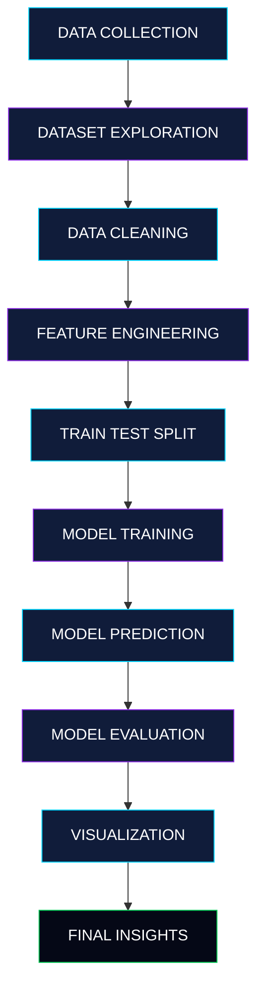

 <div align="center">


# ◈ REGRESSION NEXUS ◈

### THE FUTURE OF PREDICTIVE ANALYTICS


<br/>


<br/><br/>

**Where mathematics meets machine learning, and data becomes prediction.**

</div>

---

# ◈ 01. PROJECT OVERVIEW

Welcome to **Regression-Dataset**, a machine learning and data science repository dedicated to exploring regression algorithms, datasets, predictive modelling and advanced analytical visualizations.

This repository is designed to explore how computers learn relationships between variables and use mathematical models to estimate continuous numerical outcomes.

### The mission

- Explore different regression datasets.
- Understand relationships between independent and dependent variables.
- Build predictive machine learning models.
- Perform Exploratory Data Analysis (EDA).
- Visualize data using 2D and 3D graphs.
- Evaluate models using statistical performance metrics.
- Understand the mathematics behind prediction.

> DATA IS THE FOUNDATION. REGRESSION IS THE MODEL. PREDICTION IS THE RESULT.

---

# ◈ 02. REGRESSION VISUALIZATION GALLERY

<div align="center">

### SIX WINDOWS INTO THE WORLD OF REGRESSION

**01 — Linear Regression**


*Understanding the relationship between variables and the best-fit line.*

---

**02 — Polynomial Regression**


*Exploring nonlinear relationships through polynomial features.*

---

**03 — Residual Analysis**


*Examining prediction errors and model assumptions.*

---

**04 — Actual vs Predicted Values**


*Comparing observed values against model predictions.*

---

**05 — Feature Importance**


*Understanding the contribution of individual input features.*

---

**06 — Model Learning Curve**


*Studying how model performance changes during training.*

</div>

> **Gallery note:** These are illustrative charts with sample values, not results from an actual trained model. Replace them with plots generated from your own datasets as your project grows.

---

# ◈ 03. REGRESSION ALGORITHM UNIVERSE

| Algorithm | Description | Application |
|---|---|---|
| Linear Regression | Models linear relationships | Price prediction |
| Multiple Linear Regression | Uses multiple independent variables | Sales forecasting |
| Polynomial Regression | Models nonlinear relationships | Growth analysis |
| Ridge Regression | Uses L2 regularization | Reducing overfitting |
| Lasso Regression | Uses L1 regularization | Feature selection |
| Elastic Net | Combines L1 and L2 regularization | Complex datasets |
| Decision Tree Regression | Learns decision-based patterns | Prediction tasks |
| Random Forest Regression | Combines multiple decision trees | Robust prediction |
| Support Vector Regression | Uses support vector methods | Nonlinear prediction |

---

# ◈ 04. THE MATHEMATICAL CORE

### Simple Linear Regression

The fundamental equation:

\[
\hat{y}=b_0+b_1x
\]

Where:

- \(\hat{y}\) = Predicted output
- \(b_0\) = Intercept
- \(b_1\) = Regression coefficient
- \(x\) = Independent variable

### Model Evaluation Metrics

| Metric | Purpose |
|---|---|
| MAE | Mean Absolute Error |
| MSE | Mean Squared Error |
| RMSE | Root Mean Squared Error |
| R² Score | Explained variance |
| Adjusted R² | R² adjusted for model complexity |

---

# ◈ 05. TECHNOLOGY STACK

<div align="center">

### Programming & Development


### Data Science & Machine Learning


</div>

---

# ◈ 06. DATASET EXPLORER

Potential datasets for regression experiments:

| Dataset | Prediction Target | Dataset Type |
|---|---|---|
| House Prices | House Sale Price | Real Estate |
| Salary Dataset | Salary | Employment |
| Advertising Dataset | Sales | Marketing |
| Student Performance | Academic Score | Education |
| Medical Cost Dataset | Insurance Cost | Healthcare |
| California Housing | Median House Value | Real Estate |
| Diabetes Dataset | Disease Progression Measure | Healthcare |
| Automobile Dataset | Vehicle Price | Automotive |

**Dataset sources:**

- [Kaggle Datasets](https://www.kaggle.com/datasets)
- [UCI Machine Learning Repository](https://archive.ics.uci.edu/)
- [Scikit-learn Datasets](https://scikit-learn.org/stable/datasets.html)

---

# ◈ 07. 3D REGRESSION DIMENSION

<div align="center">


### Beyond 2D. Into multidimensional prediction.

</div>

Explore regression in three-dimensional space:

- 3D Scatter Plots
- Multiple Linear Regression Planes
- 3D Polynomial Surfaces
- Interactive Prediction Visualization
- Multivariable Data Exploration

### Launch the live dashboard

**Live interactive dashboard:** [Open REGRESSION NEXUS 3D](https://YOUR_GITHUB_USERNAME.github.io/Regression-Dataset/)

*Replace the URL with your published GitHub Pages address once the dashboard is deployed.*

For a live dashboard, use Plotly's interactive 3D visualizations and publish the generated HTML through GitHub Pages. GitHub README itself cannot execute an embedded interactive Plotly application.

---

# ◈ 08. PROJECT ARCHITECTURE

```text
REGRESSION-DATASET/
│
├── 📁 Datasets/
│   ├── CSV/
│   ├── Excel/
│   └── Sample_Data/
│
├── 📁 Linear_Regression/
│   ├── Simple_Linear_Regression/
│   └── Multiple_Linear_Regression/
│
├── 📁 Polynomial_Regression/
│
├── 📁 Regularization/
│   ├── Ridge/
│   ├── Lasso/
│   └── Elastic_Net/
│
├── 📁 Tree_Regression/
│   ├── Decision_Tree/
│   └── Random_Forest/
│
├── 📁 Visualization/
│   ├── 2D_Plots/
│   ├── 3D_Plots/
│   └── Residual_Analysis/
│
├── 📁 Model_Evaluation/
│
├── 📁 Images/
│
├── 📁 Dashboard/
│
└── README.md
```

---

# ◈ 09. MACHINE LEARNING PIPELINE



---

# ◈ 10. GITHUB ANALYTICS CENTER

<div align="center">


</div>

---

# ◈ 11. CONTRIBUTION SNAKE

<div align="center">


</div>

*Requires a configured GitHub Actions workflow in your profile repository to generate the animation.*

---

# ◈ 12. PROJECT ROADMAP

- [x] Create regression project identity
- [x] Add visualization gallery
- [x] Document regression algorithms
- [x] Add machine learning workflow
- [ ] Upload original regression datasets
- [ ] Implement complete regression models
- [ ] Add real model evaluation reports
- [ ] Build interactive 3D dashboard
- [ ] Publish dashboard using GitHub Pages
- [ ] Add downloadable project notebooks

---

# ◈ 13. CONNECT WITH THE PROJECT

<div align="center">

<a href="https://github.com/YOUR_GITHUB_USERNAME/Regression-Dataset">

</a>

<a href="https://github.com/YOUR_GITHUB_USERNAME">

</a>

<br/><br/>

### ⭐ SUPPORT THE PROJECT

If you find this repository interesting, consider giving it a star!

**LEARN. ANALYZE. PREDICT. INNOVATE.**

### THE FUTURE IS PREDICTABLE. THE POSSIBILITIES ARE INFINITE.


</div>


Regression-Dataset/
│
├── Datasets/
├── Linear_Regression/
├── Multiple_Regression/
├── Polynomial_Regression/
├── Random_Forest/
├── Visualization/
├── Dashboard/
├── Images/
└── README.md
